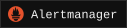
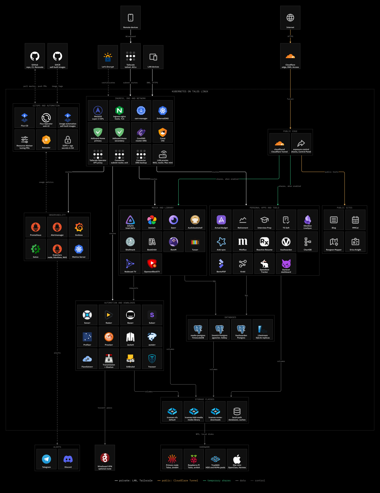
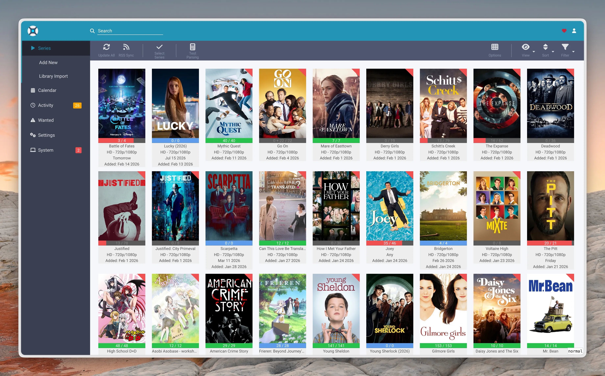
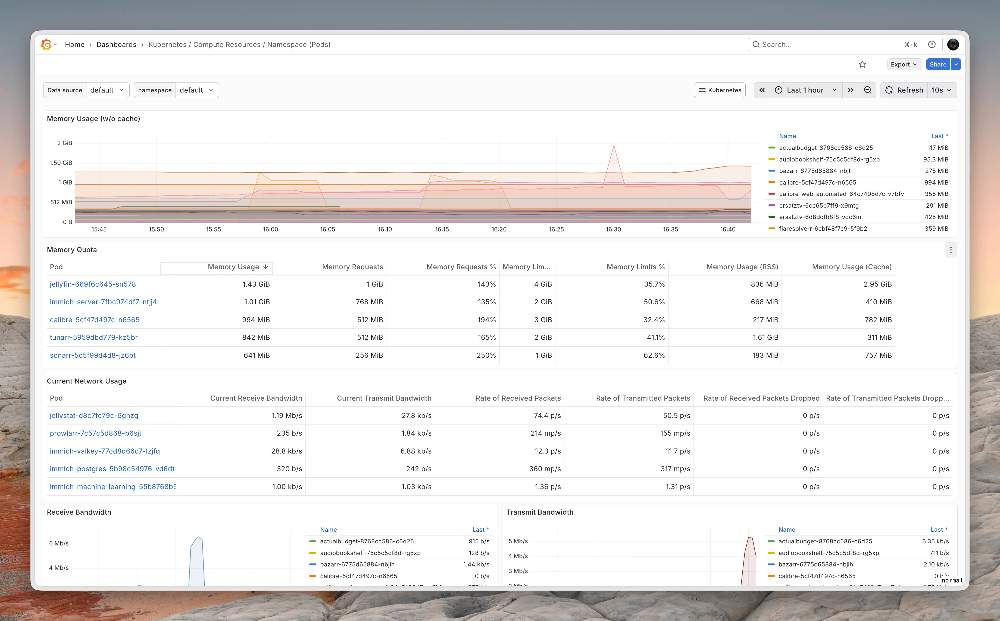
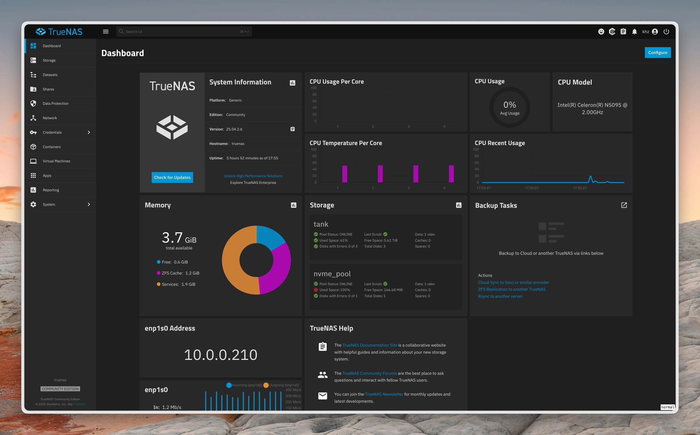

<div align="center">

# rangoonpulse

[](https://github.com/khzaw/rangoonpulse/actions/workflows/ci.yaml)

Two Talos Kubernetes nodes, TrueNAS storage, and Flux keeping everything in sync. It runs media, photos, books, personal apps, and the tools that keep them running. Most services stay on LAN and Tailscale; public sites and temporary shares have their own Cloudflare Tunnel routes.

<table>
  <tr>
    <th align="left">Cluster</th>
    <td align="left">
      <a href="https://www.talos.dev/"></a>
      <a href="https://kubernetes.io/"></a>
      <a href="docs/canal.md"></a>
      <a href="https://coredns.io/"></a>
    </td>
  </tr>
  <tr>
    <th align="left">GitOps</th>
    <td align="left">
      <a href="https://fluxcd.io/"></a>
      <a href="https://helm.sh/"></a>
      <a href="https://docs.renovatebot.com/"></a>
      <a href="https://github.com/getsops/sops"></a>
      <a href="#cicd-workflows"></a>
    </td>
  </tr>
  <tr>
    <th align="left">Ingress and TLS</th>
    <td align="left">
      <a href="https://kubernetes.github.io/ingress-nginx/"></a>
      <a href="https://cert-manager.io/"></a>
      <a href="https://letsencrypt.org/"></a>
    </td>
  </tr>
  <tr>
    <th align="left">Edge and DNS</th>
    <td align="left">
      <a href="https://developers.cloudflare.com/cloudflare-one/connections/connect-networks/"></a>
      <a href="https://tailscale.com/"></a>
      <a href="https://github.com/AdguardTeam/AdGuardHome"></a>
    </td>
  </tr>
  <tr>
    <th align="left">Storage</th>
    <td align="left">
      <a href="https://www.truenas.com/"></a>
      <a href="https://www.postgresql.org/"></a>
    </td>
  </tr>
  <tr>
    <th align="left">Observability</th>
    <td align="left">
      <a href="https://prometheus.io/"></a>
      <a href="https://prometheus.io/docs/alerting/latest/alertmanager/"></a>
      <a href="https://grafana.com/oss/grafana/"></a>
      <a href="https://github.com/TwiN/gatus"></a>
    </td>
  </tr>
  <tr>
    <th align="left">Apps</th>
    <td align="left">
      <a href="https://jellyfin.org/"></a>
      <a href="https://immich.app/"></a>
      <a href="https://sonarr.tv/"></a>
      <a href="https://radarr.video/"></a>
      <a href="https://github.com/dani-garcia/vaultwarden"></a>
      <a href="https://miniflux.app/"></a>
    </td>
  </tr>
</table>

[](docs/diagrams/service-map.png?raw=1)

**Click to open the full-size image.** What runs here and how traffic reaches it. White lines are the private path, amber is public through Cloudflare Tunnel, green is a temporary share. Rendered by `make diagrams` from [this D2 file](docs/diagrams/service-map.d2). [How to read it](docs/diagrams.md).

[How it works](#how-it-works) · [Architecture](#architecture) · [Hardware](#hardware) · [Services](#services) · [Workflows](#cicd-workflows) · [Screenshots](#screenshots) · [Docs](docs/README.md)

</div>

---

## How it works

Talos runs the two nodes. Everything after that comes through Git.

```text
push to master
   ├─ CI validates manifests, docs, and diagrams, then checks CPU headroom for changed workloads
   └─ Flux reconciles flux/ onto the cluster
         ├─ SOPS and age decrypt secrets in the cluster, so none are committed in plaintext
         ├─ ingress-nginx, cert-manager, and ExternalDNS publish private hosts with TLS and DNS
         └─ Cloudflare Tunnel publishes the public sites, and exposure-control gates temporary shares
```

Each service is one directory under `apps/` and one Flux Kustomization under `flux/kustomizations/`. A new workload is a new directory and a new entry in [the reconciliation tree](flux/kustomization.yaml).

[](docs/diagrams/gitops-loop.png?raw=1)

People are not the only writers. Four automations change the cluster by changing Git:

- **Renovate** opens chart, image, and GitHub Actions update PRs every six hours.
- **Flux image automation** commits new tags for the self-built images.
- **[Resource Advisor](docs/resource-advisor.md)** reads retained Prometheus metrics and opens budgeted resource-tuning PRs. CI renders the affected workloads and checks CPU capacity, including room for rollouts and scheduled jobs.
- **The Control Panel** commits SOPS-encrypted secret edits.

Flux owns permanent desired state; the Control Panel owns temporary share and routing state. The two AdGuard instances have independent storage and rollout boundaries, so DNS updates proceed one instance at a time.

---

## Highlights

| Feature | How it works here |
|---|---|
| **GitOps first** | Flux reconciles Kustomizations and HelmReleases from this repository. |
| **Private by default** | LAN and Tailscale clients share an ingress VIP; public access is explicitly wired through Cloudflare Tunnel. |
| **Two architectures** | An AMD64 primary node handles the heavier workloads; an ARM64 Raspberry Pi runs utility services. |
| **Storage by workload** | TrueNAS provides shared files and media; node-local storage handles latency-sensitive databases and caches. |
| **Resource tuning** | Resource Advisor uses Prometheus data to propose budgeted resource changes through pull requests. |
| **Control Panel** | A private interface for temporary shares, telemetry, a Git-to-cluster activity timeline, deployments, scheduled jobs, secrets, and resource tuning. |
| **Encrypted secrets** | SOPS + age protects Git-managed secrets; Flux decrypts them in the cluster. |
| **Diagrams as code** | The diagrams on this page are [D2 sources](docs/diagrams/) rendered by a pinned toolchain. CI fails when a source changes without a render. |

---

## Architecture

Private ingress, permanent public sites, and temporary shares follow three distinct paths:

| Path | Route | Carries |
|---|---|---|
| **Private** | LAN or Tailscale client → MetalLB ingress VIP → ingress-nginx → Service | Every app's canonical host |
| **Public** | Cloudflare edge → Cloudflare Tunnel → Service | The self-built public sites |
| **Temporary share** | Cloudflare edge → Cloudflare Tunnel → exposure-control → Service | Selected apps, while a share is enabled |

Public routes normally bypass MetalLB and ingress-nginx. Canonical app hosts stay private unless explicitly published; temporary shares have separate hostnames and expiry controls. See [networking](docs/networking.md) for routing details.

Dual AdGuard Home instances serve LAN DNS. Cluster and node DNS use separate public upstreams so they do not depend on the LAN filtering path.

### Hardware

| Machine | Role | Architecture | Hardware |
|---|---|---|---|
| Primary server | Control plane and primary workloads | `amd64` | 6 CPU cores · 32 GB RAM · Intel iGPU for media |
| Raspberry Pi | Utility workloads | `arm64` | 4 CPU cores · 8 GB RAM |
| TrueNAS | Shared storage over NFS | | HDD pool for media · NVMe pool for downloads |
| Mac mini | Native services and independent monitoring, outside the cluster | `arm64` | Apple M4 · 24 GB RAM |

Both cluster nodes run [Talos Linux](https://www.talos.dev/). Shared configuration lives in [cluster settings](flux/cluster-settings.yaml); the [architecture guide](docs/architecture.md) explains how the components fit together.

### Storage

| Storage class | Purpose |
|---|---|
| `truenas-nfs` | Default relocatable storage for ordinary persistent data, books, and audiobooks |
| `truenas-hdd-media` | Large shared media datasets |
| `truenas-nvme-downloads` | Shared download workload data |
| `local-path` | Latency-sensitive databases, SQLite, Prometheus/Grafana state, and caches |

[democratic-csi](https://github.com/democratic-csi/democratic-csi) provisions the TrueNAS classes. `local-path` is node-affined: moving a workload requires moving its data, not just changing its node selector. See [data protection](docs/data-protection.md) for backup coverage and recovery gaps.

---

## Services

The services below are declared in [the Flux reconciliation tree](flux/kustomization.yaml). Individual manifests contain their deployment settings and version pins.

### Platform and operations

| Area | Components |
|---|---|
| **Cluster** | [Talos Linux](https://www.talos.dev/), [Canal](docs/canal.md) CNI, CoreDNS |
| **Delivery** | [Flux CD](https://fluxcd.io/), [Helm](https://helm.sh/), [Flux Operator](https://github.com/controlplaneio-fluxcd/flux-operator) UI, image automation, [Renovate](https://docs.renovatebot.com/), [Reloader](https://github.com/stakater/Reloader) |
| **Networking** | [ingress-nginx](https://kubernetes.github.io/ingress-nginx/), [MetalLB](https://metallb.io/), [cert-manager](https://cert-manager.io/), [ExternalDNS](https://github.com/kubernetes-sigs/external-dns), [Tailscale Operator](https://tailscale.com/kb/1236/kubernetes-operator), subnet/exit Connector and independent DNS backup Connector |
| **DNS and public edge** | Dual [AdGuard Home](https://github.com/AdguardTeam/AdGuardHome), [Cloudflare Tunnel](https://developers.cloudflare.com/cloudflare-one/connections/connect-networks/), [exposure-control](docs/public-edge-and-exposure-control.md) |
| **Observability** | [Prometheus](https://prometheus.io/), Alertmanager, [Grafana](https://grafana.com/oss/grafana/), node exporter, [Metrics Server](https://github.com/kubernetes-sigs/metrics-server), [Gatus](docs/gatus.md) |
| **Operations** | [Resource Advisor](docs/resource-advisor.md), Control Panel, host telemetry, power estimates, and independent cluster health checks |
| **Secrets** | [SOPS](https://github.com/getsops/sops) with [age](https://github.com/FiloSottile/age), decrypted by Flux |
| **Storage** | [TrueNAS](https://www.truenas.com/), [democratic-csi](https://github.com/democratic-csi/democratic-csi), [local-path provisioner](https://github.com/rancher/local-path-provisioner) |

### Media and library

| Service | Purpose |
|---|---|
| **Jellyfin** | Media streaming with Intel iGPU access |
| **Immich** | Photo and video library |
| **Seerr** | Media requests |
| **Audiobookshelf** | Audiobooks and podcasts |
| **Shelfmark** | Book and audiobook downloads |
| **BookOrbit** | E-book library and web reader |
| **[RomM](docs/romm.md)** | ROM library, metadata, and browser emulation |

### Automation and TV

| Area | Services |
|---|---|
| **Library management** | Sonarr, Radarr, Profilarr |
| **Indexers and discovery** | Prowlarr, Jackett, autobrr, Flaresolverr |
| **Downloads** | Transmission, SABnzbd |
| **Subtitles** | Bazarr, Subarr |
| **Playback analytics** | Tracerr / Tracearr |
| **TV and devices** | Nodecast TV, Tunarr, iSponsorBlockTV |

### Personal apps and tools

| Area | Services |
|---|---|
| **Finance** | Actual Budget, Retirement |
| **Study and notes** | Interview Prep, Obsidian LiveSync, Anki sync |
| **RSS** | [Miniflux](docs/miniflux.md) |
| **Personal tools** | 75 Soft, Reactive Resume, Vaultwarden, ChartDB, BentoPDF |
| **Dashboards and utilities** | Dynacat, Speedtest Tracker, Kroki, Flux UI |
| **Self-built public sites** | [Blog](https://blog.khzaw.dev), [MMCal](https://mmcal.khzaw.dev), [Rangoon Mapper](https://rangoonmapper.khzaw.dev), [Erica Knight](https://ericaknight.me) |

---

## CI/CD workflows

| Workflow | Trigger | Purpose |
|---|---|---|
| [**CI**](.github/workflows/ci.yaml) | Push to `master`, pull request, manual | Runs `make validate-all`, the PromQL alert tests, and the power ledger SQL test, then checks CPU headroom for changed workloads |
| [**Renovate**](.github/workflows/renovate.yaml) | Every six hours, manual | Opens chart, image, and GitHub Actions update PRs |
| [**Exposure CLI image**](.github/workflows/exposure-cli.yaml) | Push to `master` and pull request that touch the CLI, manual | Tests and builds the native exposure CLI for `amd64` and `arm64`; pushes to `master` publish the multi-architecture image to GHCR |
| [**Power tariff update**](.github/workflows/power-tariff.yaml) | Daily, manual | Fetches the official electricity tariff and opens a PR when the power-cost rules change |

Flux image automation and Resource Advisor run inside the cluster, not in GitHub Actions. See [dependency updates](docs/dependency-updates-renovate-and-flux-image-automation.md) for which automation owns which version field.

---

## Screenshots

Illustrative UI captures. Metrics, versions, and library contents vary over time; the service inventory above describes the repository's desired state.

### Dynacat dashboard


<details>
<summary>Dynacat service health</summary>


</details>

<details>
<summary>Sonarr and Radarr</summary>




</details>

<details>
<summary>Grafana</summary>



</details>

<details>
<summary>TrueNAS storage</summary>



</details>

---

## Repository layout

```text
.
├── apps/                         User-facing workloads
├── core/                         Cluster-wide foundations
├── infrastructure/               Storage, monitoring, DNS, access, secrets, automation
├── flux/                         Sources and reconciliation tree
│   ├── cluster-settings.yaml     Shared non-secret constants
│   └── kustomizations/           Component reconciliation boundaries
├── docs/                         Current operating guidance
│   └── diagrams/                 D2 diagram sources and their rendered images
├── .agents/skills/               Repository procedures and safety gates
├── scripts/                      Validation and operator tooling
├── native/                       Native host integrations
└── AGENTS.md                     Agent session entrypoint
```

Talos node lifecycle is managed separately from Flux. Generated machine configuration and local operator files are excluded from Git.

---

## Working with this repository

This repository configures a specific homelab. Its DNS, node identities, and storage settings need adapting for another environment.

The [operating reference](docs/README.md) explains component ownership, maintenance, and recovery. [AGENTS.md](AGENTS.md) is the entry point for coding agents.

```bash
make validate-all   # repository checks, also run by CI
make diagrams       # re-render docs/diagrams/*.d2 (needs Docker)
make badges         # re-render the tags in .github/badges/
```

Validation also builds and tests the native Rust exposure CLI. Rustup selects the toolchain pinned in `apps/exposure-control/cli/rust-toolchain.toml` when Cargo runs from that directory.

---

## Documentation

| Guide | What it covers |
|---|---|
| [Docs index](docs/README.md) | All current operating guidance |
| [Architecture](docs/architecture.md) | Sources of truth and cross-cutting configuration |
| [Diagrams](docs/diagrams.md) | How to read, render, and change the diagrams on this page |
| [Networking](docs/networking.md) | Private ingress, public Tunnel, DNS, and edge exceptions |
| [Exposure CLI](docs/exposure-cli.md) | CLI commands, defaults, and kubectl usage without a checkout |
| [AdGuard DNS](docs/adguard-dns-stack-overview.md) | Dual DNS architecture and rollout safety |
| [Resource Advisor](docs/resource-advisor.md) | Reporting, tuning policy, and apply-PR automation |
| [CPU headroom](docs/cpu-headroom-validation.md) | Git/CI and live capacity preflights |
| [Data protection](docs/data-protection.md) | Backup coverage, recovery, and gaps |
| [Secrets](docs/secrets-management.md) | SOPS, Flux, Control Panel editing, and key lifecycle |
