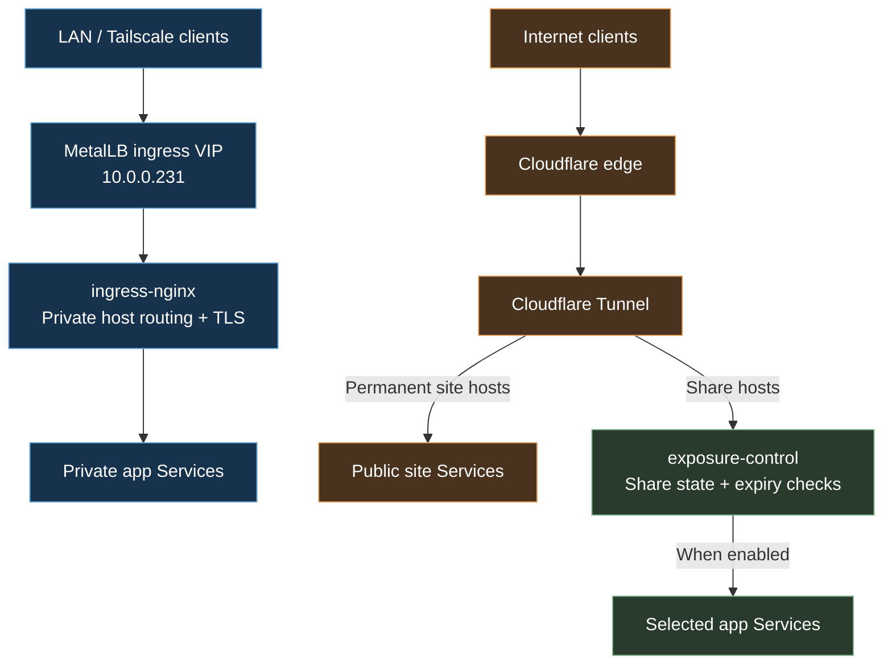
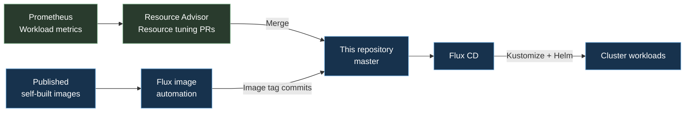
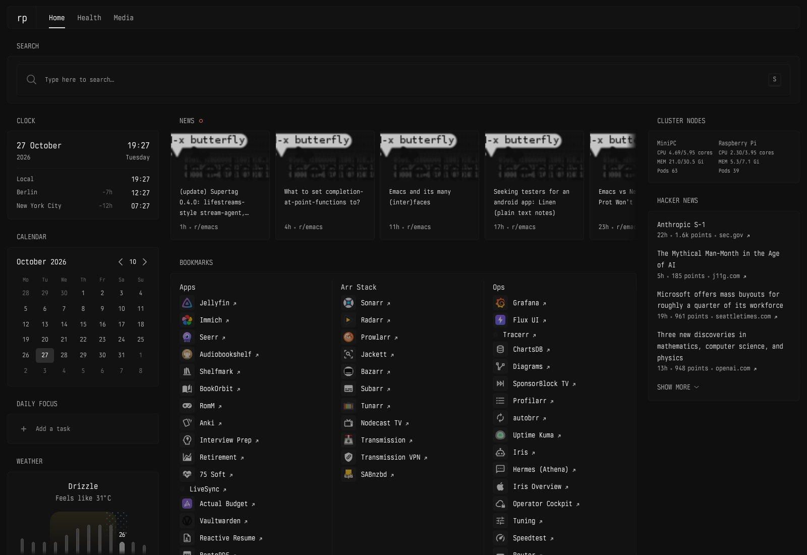
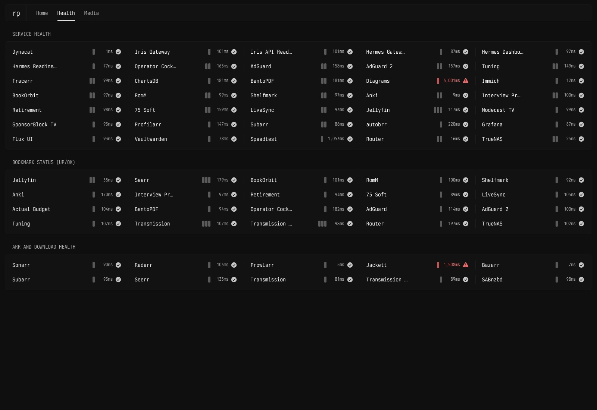
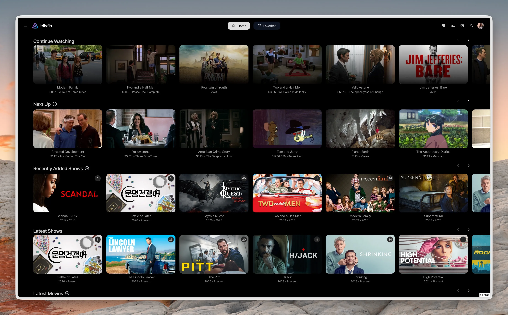
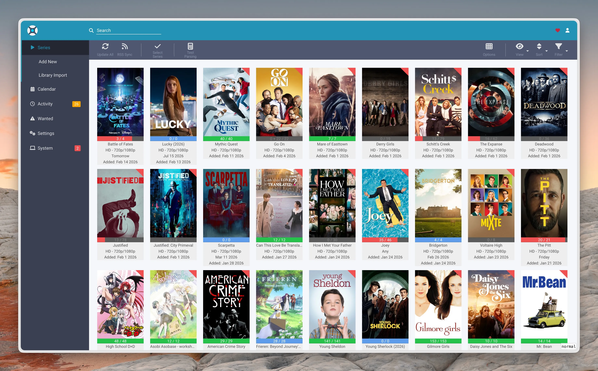
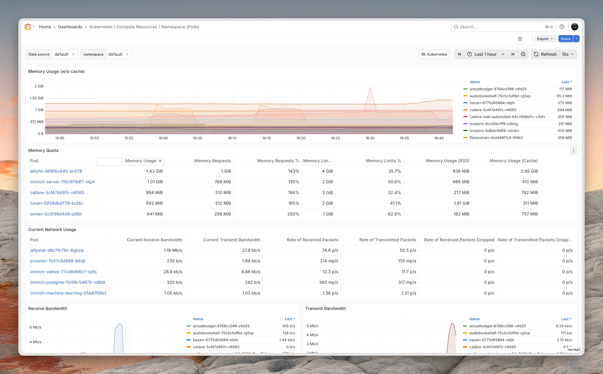
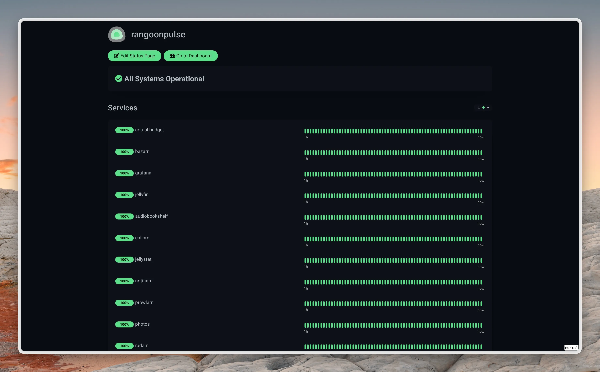
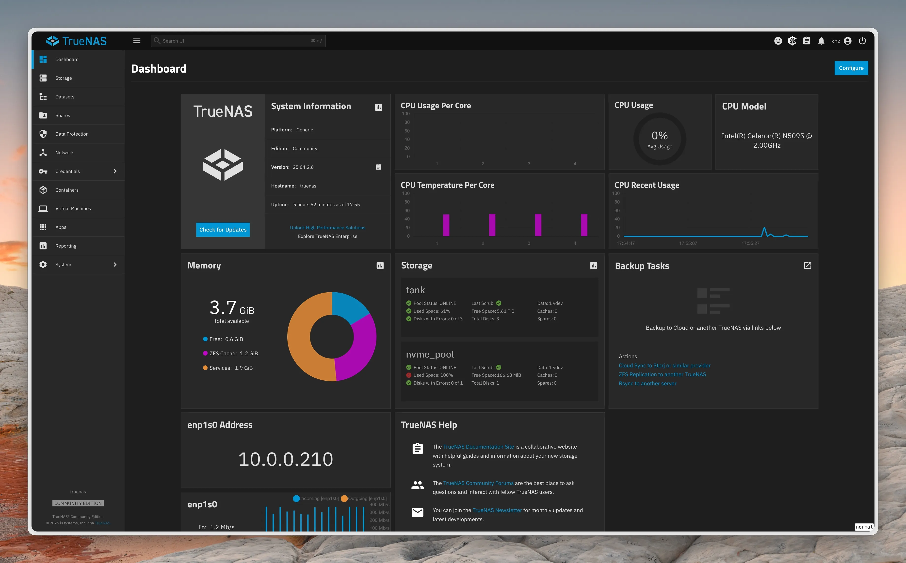

# rangoonpulse

[](https://kubernetes.io/)
[](https://talos.dev/)
[](https://fluxcd.io/)
[](#gitops-and-automation)
[](https://github.com/khzaw/rangoonpulse/actions/workflows/ci.yaml)

> My homelab, defined in Git: two Talos Kubernetes nodes, TrueNAS storage, and Flux keeping everything in sync.

Media, photos, books, personal apps, and the tools that keep them running. Most services stay on LAN and Tailscale; public sites and temporary shares have their own Cloudflare Tunnel routes.

[Architecture](#architecture) · [Hardware](#hardware) · [Services](#services) · [Screenshots](#screenshots) · [Operations](#operations) · [Docs](docs/README.md)

## Architecture

Private ingress, permanent public sites, and temporary shares follow three distinct paths:



The public routes normally bypass MetalLB and ingress-nginx. Most canonical `*.khzaw.dev` app hosts stay private; a share needs matching DNS, Tunnel, and exposure-control configuration. See [networking](docs/networking.md) and [public edge and exposure control](docs/public-edge-and-exposure-control.md).

Dual AdGuard Home instances serve LAN DNS at `10.0.0.233` and `10.0.0.234`. Cluster and node DNS use separate public upstreams so they do not depend on the LAN filtering path.

### Hardware

| Node | Role | Architecture | Hardware | Address |
|---|---|---|---|---|
| `talos-7nf-osf` | Control plane and primary workloads | `amd64` | 6 CPU cores · 32 GB RAM · Intel iGPU for media | `10.0.0.197` |
| `talos-uua-g6r` | Utility workloads | `arm64` | Raspberry Pi · 4 CPU cores · 8 GB RAM | `10.0.0.38` |

TrueNAS at `10.0.0.210` provides shared storage. The Mac mini at `10.0.0.66` runs OpenClaw and Hermes as native macOS processes, with Kubernetes proxying their HTTPS hosts through the dedicated edge VIP `10.0.0.235`. Iris SSH uses that same VIP through a separate LoadBalancer Service.

Node names, addresses, and other shared constants live in [cluster settings](flux/cluster-settings.yaml). Query Kubernetes for live health and versions rather than relying on a README status snapshot.

### Storage

[](https://www.truenas.com/)
[](https://github.com/democratic-csi/democratic-csi)
[](https://github.com/getsops/sops)
[](https://age-encryption.org/)

| Storage class | Purpose |
|---|---|
| `truenas-nfs` | Default relocatable storage for ordinary persistent data, books, and audiobooks |
| `truenas-hdd-media` | Large shared media datasets |
| `truenas-nvme-downloads` | Shared download workload data |
| `local-path` | Latency-sensitive databases, SQLite, Prometheus/Grafana state, and caches |

`local-path` is node-affined: moving a workload requires moving its data, not just changing its node selector. See [data protection](docs/data-protection.md) for backup coverage and recovery gaps.

## Highlights

| Feature | How it works here |
|---|---|
| **GitOps first** | Flux reconciles Kustomizations and HelmReleases from this repository. |
| **Private by default** | LAN and Tailscale clients share an ingress VIP; public access is explicitly wired through Cloudflare Tunnel. |
| **Two architectures** | An AMD64 primary node handles the heavier workloads; an ARM64 Raspberry Pi runs utility services. |
| **Storage by workload** | TrueNAS provides shared files and media; node-local storage handles latency-sensitive databases and caches. |
| **Resource tuning** | Resource Advisor uses Prometheus data to propose budgeted resource changes through pull requests. |
| **Operator cockpit** | Exposure controls, telemetry, deploy actions, jobs, secrets, and tuning in one private control panel. |
| **Encrypted secrets** | SOPS + age protects Git-managed secrets; Flux decrypts them in the cluster. |

## Services

This is the desired-state overview. [The Flux reconciliation tree](flux/kustomization.yaml) owns the active inventory; a leftover directory alone does not make a service deployed.

### Platform and operations

[](https://helm.sh/)
[](https://nginx.org/)
[](https://www.cloudflare.com/)
[](https://tailscale.com/)
[](https://prometheus.io/)
[](https://grafana.com/)

| Area | Components |
|---|---|
| **Delivery** | Flux CD, Helm, Flux Operator UI, image automation, Renovate |
| **Networking** | ingress-nginx, MetalLB, cert-manager, ExternalDNS, Tailscale Operator and subnet/exit Connector |
| **DNS and public edge** | Dual AdGuard Home, Cloudflare Tunnel, exposure-control |
| **Observability** | Prometheus, Alertmanager, Grafana, node exporter, Metrics Server, Uptime Kuma |
| **Operations** | Resource Advisor, operator cockpit, native Iris telemetry and independent cluster sentinel |
| **Storage** | TrueNAS, democratic-csi, local-path provisioner |

### Media and library

| Service | Purpose |
|---|---|
| **Jellyfin** | Media streaming with Intel iGPU access |
| **Immich** | Photo and video library |
| **Seerr** | Media requests |
| **Audiobookshelf** | Audiobooks and podcasts |
| **Shelfmark** | Book and audiobook downloads |
| **BookOrbit** | E-book library and web reader |
| **[RomM](docs/romm.md)** | ROM library, metadata, and browser emulation |

### Automation and TV

| Area | Services |
|---|---|
| **Library management** | Sonarr, Radarr, Profilarr |
| **Indexers and discovery** | Prowlarr, Jackett, autobrr, Flaresolverr |
| **Downloads** | Transmission, SABnzbd |
| **Subtitles** | Bazarr, Subarr |
| **Playback analytics** | Tracerr / Tracearr |
| **TV and devices** | Nodecast TV, Tunarr, iSponsorBlockTV |

Transmission's optional VPN sidecar still contains placeholder network material; direct mode is the safe default. See [the routing contract](docs/transmission-optional-vpn.md).

### Personal apps and tools

| Area | Services |
|---|---|
| **Finance** | Actual Budget, Retirement |
| **Study and notes** | Interview Prep, Obsidian LiveSync, Anki sync |
| **Personal tools** | 75 Soft, Reactive Resume, Vaultwarden, ChartDB, BentoPDF |
| **Dashboards and utilities** | Dynacat, Speedtest Tracker, Kroki, Flux UI |
| **Self-built sites** | Blog, MMCal, Rangoon Mapper, Erica Knight |

### Operator surfaces

| Host | Purpose |
|---|---|
| `rangoonpulse.khzaw.dev` | Dynacat Home, Health, and Media dashboard |
| `controlpanel.khzaw.dev` | Exposure controls, Pulse telemetry, travel readiness, deploys, Transmission routing, updates, CronJobs, secrets, and tuning |
| `grafana.khzaw.dev` | Metrics and operations dashboards |
| `fluxui.khzaw.dev` | Flux sources, Kustomizations, HelmReleases, and reconciliation status |

These hosts use the private LAN/Tailscale access path.

## GitOps and automation



Resource Advisor proposes resource changes through PRs. Git/CI checks render affected workloads and validate CPU headroom, rollout reserves, and scheduled-job allowances. HPA maximum replicas are checked separately. There is no live admission webhook. See [Resource Advisor](docs/resource-advisor.md) and [CPU headroom validation](docs/cpu-headroom-validation.md).

Permanent desired state belongs in Git. Git-managed secrets stay SOPS-encrypted under `infrastructure/secrets/`; runtime-owned cockpit state stays outside Flux where controls need to be reversible. The two AdGuard instances use separate rollout units.

## Screenshots

Saved UI captures, not live status. The Dynacat views were captured on 27 October 2026; the other images are existing gallery captures, so their metrics, app versions, and library contents may differ from today's setup.

### Dynacat dashboard



<details>
<summary>Dynacat service health</summary>



</details>

### Jellyfin



<details>
<summary>More from Jellyfin</summary>


</details>

<details>
<summary>Sonarr and Radarr</summary>




</details>

<details>
<summary>Grafana and Uptime Kuma</summary>





</details>

<details>
<summary>TrueNAS storage</summary>



</details>

## Repository layout

```text
.
├── apps/                         User-facing workloads
├── core/                         Cluster-wide foundations
├── infrastructure/               Storage, monitoring, DNS, access, secrets, automation
├── flux/                         Sources and reconciliation tree
│   ├── cluster-settings.yaml     Shared non-secret constants
│   └── kustomizations/           Component reconciliation boundaries
├── docs/                         Current operating guidance
├── .agents/skills/               Repository procedures and safety gates
├── scripts/                      Validation and operator tooling
├── native/iris/                  Native macOS telemetry and cluster sentinel
└── AGENTS.md                     Agent session entrypoint
```

Talos node lifecycle is managed separately from Flux; generated machine configuration and local operator files are not tracked in this repository. See [Kubernetes upgrades](docs/kubernetes-upgrade.md).

## Operations

Start with [AGENTS.md](AGENTS.md) and the [docs index](docs/README.md). Shared settings belong in [cluster settings](flux/cluster-settings.yaml); literal runtime placeholders use `$${VAR}` when Flux substitution is active.

### Common commands

```bash
# Validate the repository
make validate-all

# Flux status
flux get sources all -A
flux get kustomizations -A
flux get helmreleases -A

# Reconcile one component
flux reconcile kustomization <name> -n flux-system --with-source

# Cluster status
kubectl get nodes -o wide
kubectl get pods -A
kubectl get events -A --sort-by=.lastTimestamp
kubectl top nodes
```

See the [operations cheatsheet](docs/ops-command-cheatsheet.md) for day-two commands.

### Self-built image promotion

Blog, MMCal, Erica Knight, Interview Prep, Retirement, and Rangoon Mapper each have an independent Flux image-promotion flow. Normal promotion happens asynchronously after the source repository publishes an image. For immediate promotion:

```bash
make deploy-blog
make deploy-mmcal
make deploy-ericaknight
make deploy-itvp
make deploy-retirement
make deploy-rangoon-mapper
```

Image automation can commit to remote `master`; fetch and fast-forward after running a deploy target.

### Operating constraints

- Keep TrueNAS Tailscale **Accept Routes** disabled to avoid asymmetric NFS/API routing.
- ExternalDNS uses explicit hostname annotations and the legacy annotation-prefix compatibility flag; migrate annotations atomically before removing it.
- The generated Flux controller manifest is outside ordinary root reconciliation and requires a controlled apply during controller upgrades.
- Capacity snapshots live only on the runtime `capacity-state` branch, which must never be merged into `master`.
- New services include the integrations in [service onboarding](docs/service-onboarding.md).

## Documentation

| Guide | What it covers |
|---|---|
| [Docs index](docs/README.md) | All current operating guidance |
| [Architecture](docs/architecture.md) | Sources of truth and cross-cutting configuration |
| [Networking](docs/networking.md) | Private ingress, public Tunnel, DNS, and edge exceptions |
| [AdGuard DNS](docs/adguard-dns-stack-overview.md) | Dual DNS architecture and rollout safety |
| [Resource Advisor](docs/resource-advisor.md) | Reporting, tuning policy, and apply-PR automation |
| [CPU headroom](docs/cpu-headroom-validation.md) | Git/CI and live capacity preflights |
| [Data protection](docs/data-protection.md) | Backup coverage, recovery, and gaps |
| [Secrets](docs/secrets-management.md) | SOPS, Flux, cockpit editing, and key lifecycle |
| [Iris operations](docs/iris-operations.md) | Native macOS processes, readiness, and independent monitoring |

Docs describe the current implementation and operating contract. Superseded designs, completed plans, and incident chronology remain in Git history.
