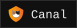
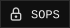
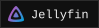
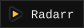
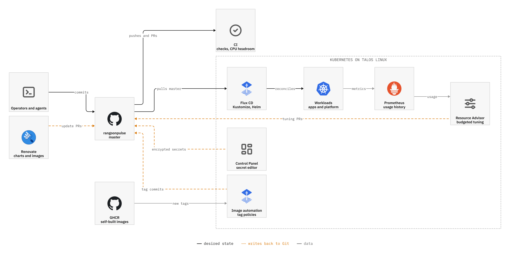
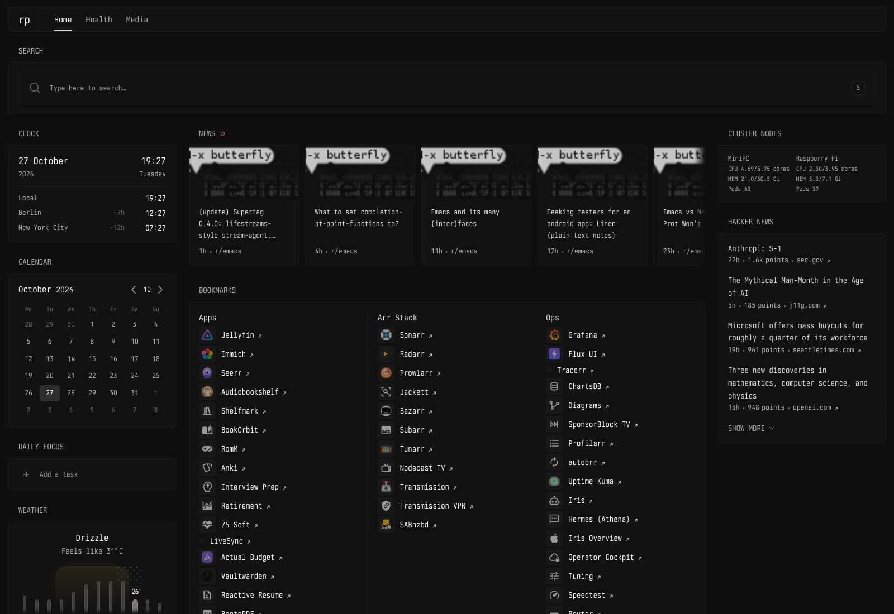
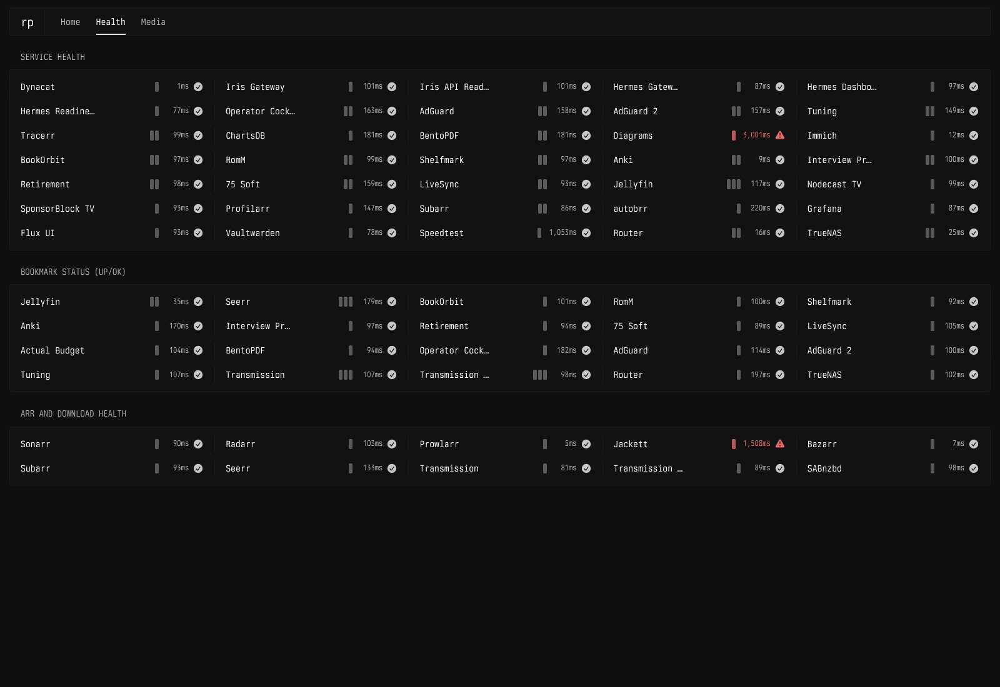
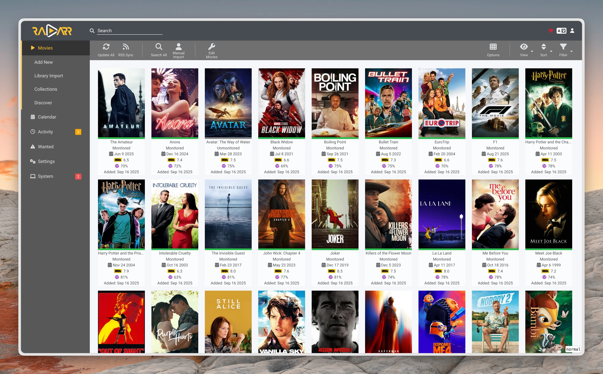

# rangoonpulse

[](https://github.com/khzaw/rangoonpulse/actions/workflows/ci.yaml)

This is where the code for my homelab Kubernetes cluster lives. At the moment the cluster consists of two nodes running Talos Linux and a NAS running TrueNAS for storage. There is also a Mac mini that hosts a Hermes agent and an OpenClaw agent.

Flux applies each commit on `master` to the cluster. Prometheus and Grafana collect and chart metrics, Alertmanager sends alerts, and Gatus checks that services respond. Renovate and Resource Advisor open pull requests for version bumps and resource changes, and Flux image automation commits new image tags. The cluster runs media, photo, and book services and personal apps. Most services are reachable only over the LAN and Tailscale. Public sites and temporary shares use Cloudflare Tunnel.

<table>
  <tr>
    <th align="left">Cluster</th>
    <td align="left">
      <a href="https://www.talos.dev/"></a>
      <a href="https://kubernetes.io/"></a>
      <a href="docs/canal.md"></a>
      <a href="https://coredns.io/"></a>
    </td>
  </tr>
  <tr>
    <th align="left">GitOps</th>
    <td align="left">
      <a href="https://fluxcd.io/"></a>
      <a href="https://helm.sh/"></a>
      <a href="https://docs.renovatebot.com/"></a>
      <a href="https://github.com/getsops/sops"></a>
      <a href="#cicd-workflows"></a>
    </td>
  </tr>
  <tr>
    <th align="left">Ingress and TLS</th>
    <td align="left">
      <a href="https://kubernetes.github.io/ingress-nginx/"></a>
      <a href="https://cert-manager.io/"></a>
      <a href="https://letsencrypt.org/"></a>
    </td>
  </tr>
  <tr>
    <th align="left">Edge and DNS</th>
    <td align="left">
      <a href="https://developers.cloudflare.com/cloudflare-one/connections/connect-networks/"></a>
      <a href="https://tailscale.com/"></a>
      <a href="https://github.com/AdguardTeam/AdGuardHome"></a>
    </td>
  </tr>
  <tr>
    <th align="left">Storage</th>
    <td align="left">
      <a href="https://www.truenas.com/"></a>
      <a href="https://www.postgresql.org/"></a>
    </td>
  </tr>
  <tr>
    <th align="left">Observability</th>
    <td align="left">
      <a href="https://prometheus.io/"></a>
      <a href="https://prometheus.io/docs/alerting/latest/alertmanager/"></a>
      <a href="https://grafana.com/oss/grafana/"></a>
      <a href="https://github.com/TwiN/gatus"></a>
    </td>
  </tr>
  <tr>
    <th align="left">Apps</th>
    <td align="left">
      <a href="https://jellyfin.org/"></a>
      <a href="https://immich.app/"></a>
      <a href="https://sonarr.tv/"></a>
      <a href="https://radarr.video/"></a>
      <a href="https://github.com/dani-garcia/vaultwarden"></a>
      <a href="https://miniflux.app/"></a>
    </td>
  </tr>
</table>

[](docs/diagrams/service-map.png?raw=1)

The service map shows each group of workloads and how traffic reaches it. Black lines are the private path, amber lines are the permanent public path through Cloudflare Tunnel, and green lines are temporary shares. Click the image to open it at full size. `make diagrams` renders it from [its D2 source](docs/diagrams/service-map.d2), and [the diagram guide](docs/diagrams.md) explains how to read it.

[How it works](#how-it-works) · [Architecture](#architecture) · [Hardware](#hardware) · [Services](#services) · [Workflows](#cicd-workflows) · [Screenshots](#screenshots) · [Docs](docs/README.md)

---

## How it works

Talos Linux runs both nodes and is managed outside Flux. Everything above the operating system comes from this repository.

```text
push to master
   ├─ CI validates manifests, docs, and diagrams, then checks CPU headroom for changed workloads
   └─ Flux reconciles flux/ onto the cluster
         ├─ Flux decrypts SOPS secrets with age, so Git holds no plaintext secrets
         ├─ ingress-nginx, cert-manager, and ExternalDNS publish private hosts with TLS and DNS
         └─ Cloudflare Tunnel publishes the public sites, and exposure-control enforces access and expiry on temporary shares
```

Each app has one directory under `apps/` and one Flux Kustomization under `flux/kustomizations/`. To add a workload, add both and list the Kustomization in [the reconciliation tree](flux/kustomization.yaml).

[](docs/diagrams/gitops-loop.png?raw=1)

Four automations also write to Git:

- Renovate opens pull requests for chart, image, and GitHub Actions updates every six hours.
- Flux image automation commits new tags for the self-built images.
- [Resource Advisor](docs/resource-advisor.md) reads retained Prometheus metrics and opens pull requests that resize workloads within a shared growth budget. CI renders each affected workload and checks that the nodes have enough CPU for it, with room left for rollouts and scheduled jobs.
- The Control Panel commits secret edits encrypted with SOPS. It is also the private web UI for temporary shares, telemetry, a timeline of Git changes reaching the cluster, deployments, scheduled jobs, and resource tuning.

Flux owns the permanent desired state. The Control Panel owns temporary share and routing state.

The two AdGuard instances run on separate nodes, with separate storage and separate Flux Kustomizations. A DNS change rolls out to one instance at a time.

---

## Architecture

Traffic reaches a service by one of three paths:

| Path | Route | Carries |
|---|---|---|
| Private | LAN or Tailscale client → MetalLB ingress VIP → ingress-nginx → Service | Every app's canonical host |
| Public | Cloudflare edge → Cloudflare Tunnel → Service | The self-built public sites |
| Temporary share | Cloudflare edge → Cloudflare Tunnel → exposure-control → Service | Selected apps, while a share is enabled |

Public routes do not pass through MetalLB or ingress-nginx. An app's canonical host stays private unless a Cloudflare Tunnel route publishes it. A temporary share uses a separate hostname and can expire on a timer. [Networking](docs/networking.md) has the routing details.

Two AdGuard Home instances serve DNS for the LAN. Cluster and node DNS queries go to public resolvers, so they do not depend on AdGuard.

### Hardware

| Machine | Role | Architecture | Hardware |
|---|---|---|---|
| Primary server | Control plane and primary workloads | `amd64` | 6 CPU cores · 32 GB RAM · Intel iGPU for media |
| Raspberry Pi | Utility workloads | `arm64` | 4 CPU cores · 8 GB RAM |
| TrueNAS | Shared storage over NFS | | HDD pool for media · NVMe pool for downloads |
| Mac mini | Native services and independent monitoring, outside the cluster | `arm64` | Apple M4 · 24 GB RAM |

Shared non-secret settings are in [cluster settings](flux/cluster-settings.yaml). The [architecture guide](docs/architecture.md) names the source of truth for each kind of configuration.

### Storage

| Storage class | Purpose |
|---|---|
| `truenas-nfs` | Default class for app data, books, and audiobooks, not tied to a node |
| `truenas-hdd-media` | Large shared media datasets |
| `truenas-nvme-downloads` | Shared download workload data |
| `local-path` | Latency-sensitive databases, SQLite, Prometheus and Grafana state, and caches |

[democratic-csi](https://github.com/democratic-csi/democratic-csi) provisions the TrueNAS classes. A `local-path` volume is stored on one node. Moving its workload to another node means moving the data as well as changing the node selector. [Data protection](docs/data-protection.md) lists what is backed up and where recovery has gaps.

---

## Services

Every service below is declared in [the Flux reconciliation tree](flux/kustomization.yaml). Its manifests hold the deployment settings and version pins.

### Platform and operations

| Area | Components |
|---|---|
| Cluster | [Talos Linux](https://www.talos.dev/), [Canal](docs/canal.md) CNI, CoreDNS |
| Delivery | [Flux CD](https://fluxcd.io/), [Helm](https://helm.sh/), [Flux Operator](https://github.com/controlplaneio-fluxcd/flux-operator) UI, image automation, [Renovate](https://docs.renovatebot.com/), [Reloader](https://github.com/stakater/Reloader) |
| Networking | [ingress-nginx](https://kubernetes.github.io/ingress-nginx/), [MetalLB](https://metallb.io/), [cert-manager](https://cert-manager.io/), [ExternalDNS](https://github.com/kubernetes-sigs/external-dns), [Tailscale Operator](https://tailscale.com/kb/1236/kubernetes-operator), a subnet and exit node Connector, and a separate DNS backup Connector |
| DNS and public edge | Two [AdGuard Home](https://github.com/AdguardTeam/AdGuardHome) instances, [Cloudflare Tunnel](https://developers.cloudflare.com/cloudflare-one/connections/connect-networks/), [exposure-control](docs/public-edge-and-exposure-control.md) |
| Observability | [Prometheus](https://prometheus.io/), Alertmanager, [Grafana](https://grafana.com/oss/grafana/), node exporter, [Metrics Server](https://github.com/kubernetes-sigs/metrics-server), [Gatus](docs/gatus.md) |
| Operations | [Resource Advisor](docs/resource-advisor.md), Control Panel, host telemetry, power estimates, and cluster health checks that run outside the cluster |
| Secrets | [SOPS](https://github.com/getsops/sops) with [age](https://github.com/FiloSottile/age), decrypted by Flux |
| Storage | [TrueNAS](https://www.truenas.com/), [democratic-csi](https://github.com/democratic-csi/democratic-csi), [local-path provisioner](https://github.com/rancher/local-path-provisioner) |

### Media and library

| Service | Purpose |
|---|---|
| Jellyfin | Media streaming with Intel iGPU transcoding |
| Immich | Photo and video library |
| Seerr | Media requests |
| Audiobookshelf | Audiobooks and podcasts |
| Shelfmark | Book and audiobook downloads |
| BookOrbit | E-book library and web reader |
| [RomM](docs/romm.md) | ROM library, metadata, and browser emulation |

### Automation and TV

| Area | Services |
|---|---|
| Library management | Sonarr, Radarr, Profilarr |
| Indexers and discovery | Prowlarr, Jackett, autobrr, Flaresolverr |
| Downloads | Transmission, SABnzbd |
| Subtitles | Bazarr, Subarr |
| Playback analytics | Tracerr / Tracearr |
| TV and devices | Nodecast TV, Tunarr, iSponsorBlockTV |

### Personal apps and tools

| Area | Services |
|---|---|
| Finance | Actual Budget, Retirement |
| Study and notes | Interview Prep, Obsidian LiveSync, Anki sync |
| RSS | [Miniflux](docs/miniflux.md) |
| Personal tools | 75 Soft, Reactive Resume, Vaultwarden, ChartDB, BentoPDF |
| Dashboards and utilities | Dynacat, [Docs site](docs/docs-site.md), Speedtest Tracker, Kroki, Flux UI |
| Self-built public sites | [Blog](https://blog.khzaw.dev), [MMCal](https://mmcal.khzaw.dev), [Rangoon Mapper](https://rangoonmapper.khzaw.dev), [Erica Knight](https://ericaknight.me) |

---

## CI/CD workflows

| Workflow | Trigger | Purpose |
|---|---|---|
| [CI](.github/workflows/ci.yaml) | Push to `master`, pull request, manual | Runs `make validate-all`, the PromQL alert tests, and the power ledger SQL test, then checks CPU headroom for changed workloads |
| [Renovate](.github/workflows/renovate.yaml) | Every six hours, manual | Opens pull requests for chart, image, and GitHub Actions updates |
| [Exposure CLI image](.github/workflows/exposure-cli.yaml) | Push to `master` or pull request that touches the CLI, manual | Tests and builds the native exposure CLI for `amd64` and `arm64`. Pushes to `master` publish the multi-architecture image to GHCR |
| [Docs site image](.github/workflows/docs-site.yaml) | Push to `master` or pull request that touches `docs/` or `docs-site/`, manual | Syncs `docs/`, builds and link-checks the Starlight portal, and pushes the multi-architecture image to GHCR on `master` |
| [Power tariff update](.github/workflows/power-tariff.yaml) | Daily, manual | Fetches the official electricity tariff and opens a pull request when the power-cost rules change |

Flux image automation and Resource Advisor run inside the cluster, not in GitHub Actions. [Dependency updates](docs/dependency-updates-renovate-and-flux-image-automation.md) lists which automation owns each version field.

---

## Screenshots

These screenshots are examples from one point in time, so their metrics, versions, and library contents go out of date. The service tables above list what the repository deploys now.

### Dynacat dashboard



<details>
<summary>Dynacat service health</summary>



</details>

<details>
<summary>Sonarr and Radarr</summary>




</details>

<details>
<summary>Grafana</summary>


</details>

<details>
<summary>TrueNAS storage</summary>


</details>

---

## Repository layout

```text
.
├── apps/                         User-facing workloads
├── core/                         Cluster-wide foundations
├── infrastructure/               Storage, monitoring, DNS, access, secrets, automation
├── flux/                         Sources and reconciliation tree
│   ├── cluster-settings.yaml     Shared non-secret constants
│   └── kustomizations/           Component reconciliation boundaries
├── docs/                         Current operating guidance
│   └── diagrams/                 D2 diagram sources and their rendered images
├── docs-site/                    Starlight static docs portal built from docs/
├── .agents/skills/               Repository procedures and safety gates
├── scripts/                      Validation and operator tooling
├── native/                       Native host integrations
└── AGENTS.md                     Agent session entrypoint
```

Talos node configuration and upgrades happen outside Flux. Generated machine configuration and local operator files stay out of Git.

---

## Working with this repository

This repository configures one specific homelab. To use it elsewhere, change its DNS names, node identities, and storage settings.

The [operating reference](docs/README.md) covers component ownership, maintenance, and recovery. [AGENTS.md](AGENTS.md) is the entry point for coding agents.

```bash
make validate-all   # repository checks, also run by CI
make diagrams       # re-render docs/diagrams/*.d2 (needs Docker)
make badges         # re-render the badges in .github/badges/
```

CI fails if a diagram source changes without a new render. Validation also builds and tests the native Rust exposure CLI. Rustup picks the toolchain pinned in `apps/exposure-control/cli/rust-toolchain.toml` when Cargo runs from that directory.

---

## Documentation

| Guide | What it covers |
|---|---|
| [Docs index](docs/README.md) | All current operating guidance |
| [Architecture](docs/architecture.md) | Sources of truth and cross-cutting configuration |
| [Diagrams](docs/diagrams.md) | How to read, render, and change the diagrams on this page |
| [Networking](docs/networking.md) | Private ingress, public Tunnel, DNS, and edge exceptions |
| [Exposure CLI](docs/exposure-cli.md) | CLI commands, defaults, and kubectl usage without a checkout |
| [AdGuard DNS](docs/adguard-dns-stack-overview.md) | Dual DNS architecture and rollout safety |
| [Resource Advisor](docs/resource-advisor.md) | Reporting, tuning policy, and apply-PR automation |
| [CPU headroom](docs/cpu-headroom-validation.md) | Git/CI and live capacity preflights |
| [Data protection](docs/data-protection.md) | Backup coverage, recovery, and gaps |
| [Secrets](docs/secrets-management.md) | SOPS, Flux, Control Panel editing, and key lifecycle |
