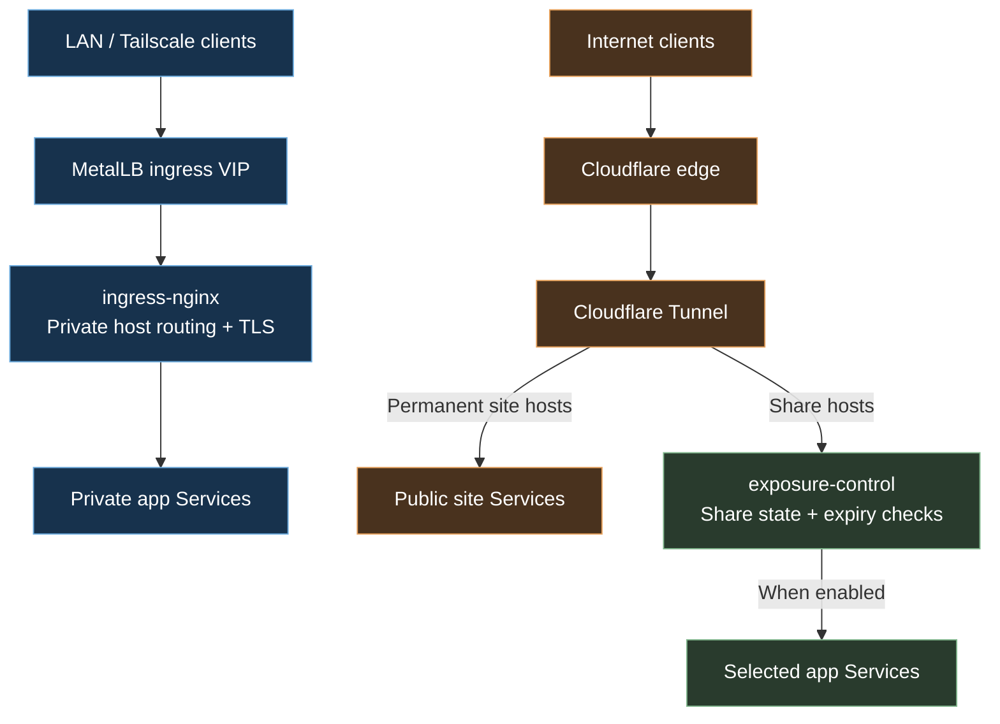
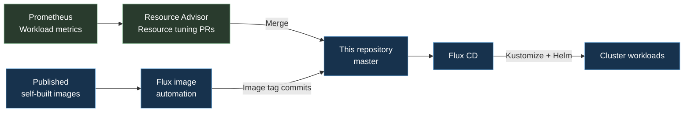
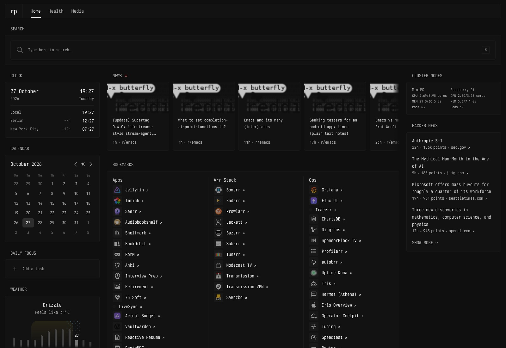
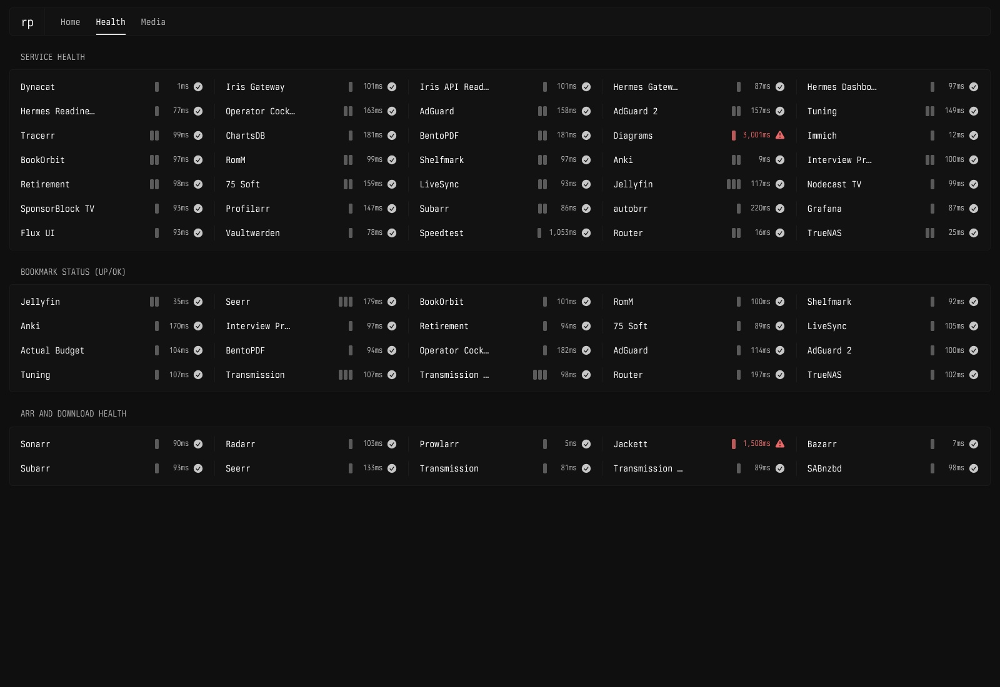
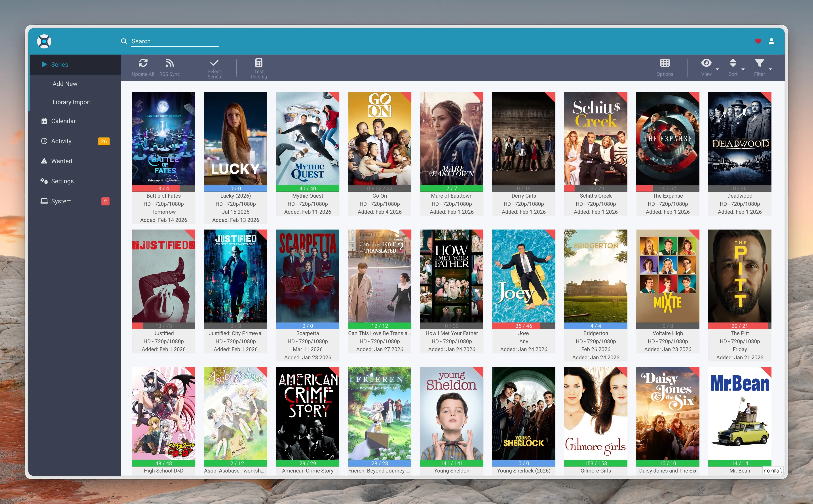
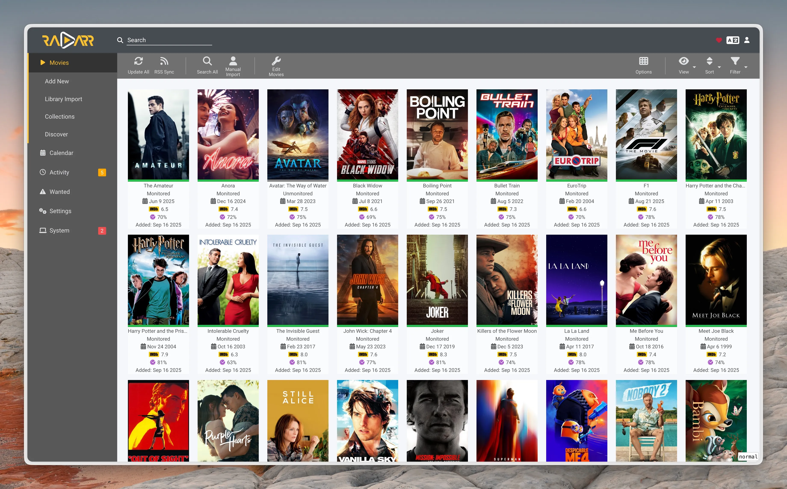
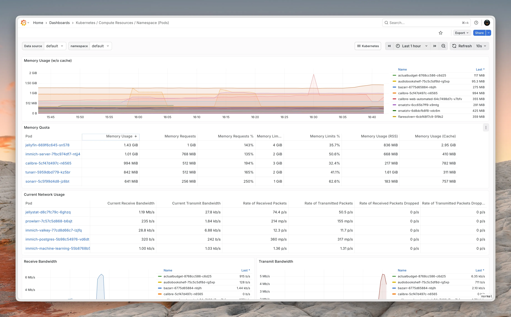
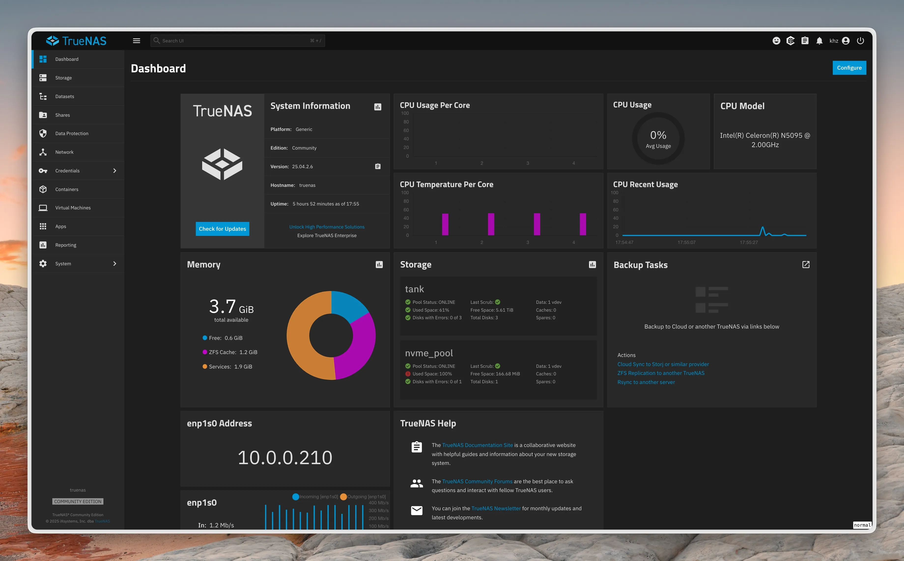

# rangoonpulse

[](https://kubernetes.io/)
[](https://talos.dev/)
[](https://fluxcd.io/)
[](#gitops-and-automation)
[](https://github.com/khzaw/rangoonpulse/actions/workflows/ci.yaml)

> My homelab, defined in Git: two Talos Kubernetes nodes, TrueNAS storage, and Flux keeping everything in sync.

Media, photos, books, personal apps, and the tools that keep them running. Most services stay on LAN and Tailscale; public sites and temporary shares have their own Cloudflare Tunnel routes.

[Architecture](#architecture) · [Hardware](#hardware) · [Services](#services) · [Screenshots](#screenshots) · [Repository layout](#repository-layout) · [Docs](docs/README.md)

## Architecture

Private ingress, permanent public sites, and temporary shares follow three distinct paths:



Public routes normally bypass MetalLB and ingress-nginx. Canonical app hosts stay private unless explicitly published; temporary shares have separate hostnames and expiry controls. See [networking](docs/networking.md) for routing details.

Dual AdGuard Home instances serve LAN DNS. Cluster and node DNS use separate public upstreams so they do not depend on the LAN filtering path.

### Hardware

| Machine | Role | Architecture | Hardware |
|---|---|---|---|
| Primary server | Control plane and primary workloads | `amd64` | 6 CPU cores · 32 GB RAM · Intel iGPU for media |
| Raspberry Pi | Utility workloads | `arm64` | 4 CPU cores · 8 GB RAM |

TrueNAS provides shared storage. A Mac mini runs native services and independent monitoring outside the Kubernetes cluster.

Shared configuration lives in [cluster settings](flux/cluster-settings.yaml); the [architecture guide](docs/architecture.md) explains how the components fit together.

### Storage

[](https://www.truenas.com/)
[](https://github.com/democratic-csi/democratic-csi)
[](https://github.com/getsops/sops)
[](https://age-encryption.org/)

| Storage class | Purpose |
|---|---|
| `truenas-nfs` | Default relocatable storage for ordinary persistent data, books, and audiobooks |
| `truenas-hdd-media` | Large shared media datasets |
| `truenas-nvme-downloads` | Shared download workload data |
| `local-path` | Latency-sensitive databases, SQLite, Prometheus/Grafana state, and caches |

`local-path` is node-affined: moving a workload requires moving its data, not just changing its node selector. See [data protection](docs/data-protection.md) for backup coverage and recovery gaps.

## Highlights

| Feature | How it works here |
|---|---|
| **GitOps first** | Flux reconciles Kustomizations and HelmReleases from this repository. |
| **Private by default** | LAN and Tailscale clients share an ingress VIP; public access is explicitly wired through Cloudflare Tunnel. |
| **Two architectures** | An AMD64 primary node handles the heavier workloads; an ARM64 Raspberry Pi runs utility services. |
| **Storage by workload** | TrueNAS provides shared files and media; node-local storage handles latency-sensitive databases and caches. |
| **Resource tuning** | Resource Advisor uses Prometheus data to propose budgeted resource changes through pull requests. |
| **Control Panel** | A private interface for temporary shares, telemetry, deployments, scheduled jobs, secrets, and resource tuning. |
| **Encrypted secrets** | SOPS + age protects Git-managed secrets; Flux decrypts them in the cluster. |

## Services

The services below are declared in [the Flux reconciliation tree](flux/kustomization.yaml). Individual manifests contain their deployment settings and version pins.

### Platform and operations

[](https://helm.sh/)
[](https://nginx.org/)
[](https://www.cloudflare.com/)
[](https://tailscale.com/)
[](https://prometheus.io/)
[](https://grafana.com/)

| Area | Components |
|---|---|
| **Delivery** | Flux CD, Helm, Flux Operator UI, image automation, Renovate |
| **Networking** | ingress-nginx, MetalLB, cert-manager, ExternalDNS, Tailscale Operator and subnet/exit Connector |
| **DNS and public edge** | Dual AdGuard Home, Cloudflare Tunnel, exposure-control |
| **Observability** | Prometheus, Alertmanager, Grafana, node exporter, Metrics Server, Uptime Kuma |
| **Operations** | Resource Advisor, Control Panel, host telemetry, power estimates, and independent cluster health checks |
| **Storage** | TrueNAS, democratic-csi, local-path provisioner |

### Media and library

| Service | Purpose |
|---|---|
| **Jellyfin** | Media streaming with Intel iGPU access |
| **Immich** | Photo and video library |
| **Seerr** | Media requests |
| **Audiobookshelf** | Audiobooks and podcasts |
| **Shelfmark** | Book and audiobook downloads |
| **BookOrbit** | E-book library and web reader |
| **[RomM](docs/romm.md)** | ROM library, metadata, and browser emulation |

### Automation and TV

| Area | Services |
|---|---|
| **Library management** | Sonarr, Radarr, Profilarr |
| **Indexers and discovery** | Prowlarr, Jackett, autobrr, Flaresolverr |
| **Downloads** | Transmission, SABnzbd |
| **Subtitles** | Bazarr, Subarr |
| **Playback analytics** | Tracerr / Tracearr |
| **TV and devices** | Nodecast TV, Tunarr, iSponsorBlockTV |

### Personal apps and tools

| Area | Services |
|---|---|
| **Finance** | Actual Budget, Retirement |
| **Study and notes** | Interview Prep, Obsidian LiveSync, Anki sync |
| **RSS** | [Miniflux](docs/miniflux.md) |
| **Personal tools** | 75 Soft, Reactive Resume, Vaultwarden, ChartDB, BentoPDF |
| **Dashboards and utilities** | Dynacat, Speedtest Tracker, Kroki, Flux UI |
| **Self-built sites** | Blog, MMCal, Rangoon Mapper, Erica Knight |

## GitOps and automation



Resource Advisor uses retained Prometheus metrics to propose resource changes through PRs. Git/CI checks render affected workloads and check CPU capacity, including room for rollouts and scheduled jobs. See [Resource Advisor](docs/resource-advisor.md) for the policy and its limits.

Flux owns permanent desired state; the Control Panel owns temporary share and routing state. Secrets are encrypted with SOPS. The two AdGuard instances have independent storage and rollout boundaries so DNS updates can proceed one instance at a time.

## Screenshots

Illustrative UI captures. Metrics, versions, and library contents vary over time; the service inventory above describes the repository's desired state.

### Dynacat dashboard



<details>
<summary>Dynacat service health</summary>



</details>

<details>
<summary>Sonarr and Radarr</summary>





</details>

<details>
<summary>Grafana</summary>



</details>

<details>
<summary>TrueNAS storage</summary>



</details>

## Repository layout

```text
.
├── apps/                         User-facing workloads
├── core/                         Cluster-wide foundations
├── infrastructure/               Storage, monitoring, DNS, access, secrets, automation
├── flux/                         Sources and reconciliation tree
│   ├── cluster-settings.yaml     Shared non-secret constants
│   └── kustomizations/           Component reconciliation boundaries
├── docs/                         Current operating guidance
├── .agents/skills/               Repository procedures and safety gates
├── scripts/                      Validation and operator tooling
├── native/                       Native host integrations
└── AGENTS.md                     Agent session entrypoint
```

Talos node lifecycle is managed separately from Flux. Generated machine configuration and local operator files are excluded from Git.

## Working with this repository

This repository configures a specific homelab. Its DNS, node identities, and storage settings need adapting for another environment.

The [operating reference](docs/README.md) explains component ownership, maintenance, and recovery. [AGENTS.md](AGENTS.md) is the entry point for coding agents. Local repository checks run with:

```bash
make validate-all
```

## Documentation

| Guide | What it covers |
|---|---|
| [Docs index](docs/README.md) | All current operating guidance |
| [Architecture](docs/architecture.md) | Sources of truth and cross-cutting configuration |
| [Networking](docs/networking.md) | Private ingress, public Tunnel, DNS, and edge exceptions |
| [AdGuard DNS](docs/adguard-dns-stack-overview.md) | Dual DNS architecture and rollout safety |
| [Resource Advisor](docs/resource-advisor.md) | Reporting, tuning policy, and apply-PR automation |
| [CPU headroom](docs/cpu-headroom-validation.md) | Git/CI and live capacity preflights |
| [Data protection](docs/data-protection.md) | Backup coverage, recovery, and gaps |
| [Secrets](docs/secrets-management.md) | SOPS, Flux, Control Panel editing, and key lifecycle |
